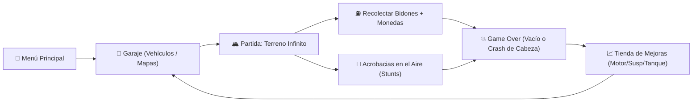

# 🏎️ Hill Climbing Temu — Simulación de Conducción y Física 2D

[](https://godotengine.org)
[](https://microsoft.com/windows)
[](LICENSE)
[](https://github.com/cesaralejandromartesbonilla-a11y/hill-climbing-temu)

Recreación moderna inspirada en el clásico *Hill Climb Racing*, desarrollada en **Godot 4.6 (Forward Plus)** con generación procedural infinita de terreno, física avanzada de ruedas por raycast, 4 superficies de fricción dinámica, partículas de polvo/nieve/barro por rueda, economía de monedas y garaje con mejoras.

---

## 🎮 Bucle Jugable (Gameplay Loop)



---

## 🚀 Cómo Ejecutar el Proyecto

1. **Requisitos:** Godot Engine 4.6 con Forward Plus.
2. **Escena Principal (`F5`):**
   - [`res://scenes/ui/main_menu.tscn`](file:///c:/Users/cesar/Desktop/games/backup/GodotProjects/00_Active/hill-climbing-temu/scenes/ui/main_menu.tscn) — Menú de inicio que da acceso al Garaje interactivo y a la selección de mapas.
3. **Escena de Juego Directa (`F6`):**
   - [`res://scenes/game/game_world.tscn`](file:///c:/Users/cesar/Desktop/games/backup/GodotProjects/00_Active/hill-climbing-temu/scenes/game/game_world.tscn) — Carga inmediata de partida con el vehículo equipado.

---

## 🌟 Características y Sistemas Implementados

### 1. Física de Vehículo y Ruedas (`scripts/vehicle/`)
- **Simulación por Raycast Wheels (`wheel.gd`):** Suspensión independiente con constante de amortiguación, compresión elástica y torque directo en el suelo.
- **Control Aéreo (Air Pitching):** Aplicación de torque angular en el aire para equilibrar el coche y aterrizar sobre las dos ruedas.
- **Rastreador de Piruetas (`stunt_tracker.gd`):** Detección en tiempo real de volteretas frontales, traseras y tiempo en el aire con bonificaciones.
- **Ragdoll / Impacto de Cabeza (`driver.gd`):** Muerte instantánea (*Neck Snap*) si la cabeza del piloto impacta violentamente contra el terreno.

### 2. Generación Procedural de Terreno y Superficies (`scripts/terrain/`)
- **Generador infinito por Chunks (`terrain_generator.gd`):** Bloques de 2000px generados por combinación de ruido y ondas senoidales con progresión de pendiente y reciclaje continuo de memoria.
- **4 Superficies Físicas Únicas (`SurfaceProfile`):**
  - **Tierra (`dirt`):** Fricción estándar $1.0$, agarre equilibrado, partículas de polvo.
  - **Hielo (`ice`):** Fricción $0.15$, baja tracción lateral, partículas de escarcha.
  - **Barro (`mud`):** Fricción $0.45$, arrastre (*drag*) de $0.15$, partículas de lodo.
  - **Arena (`sand`):** Fricción $0.55$, arrastre de $0.12$, partículas de polvo fino.
- **Emisión Dinámica de Partículas (`vehicle_effects.gd`):** Cada rueda detecta la superficie bajo su punto de contacto y activa emisores `GPUParticles2D` correspondientes.

### 3. Garaje, Mejoras y Economía (`scripts/ui/` & `scripts/upgrades/`)
- **Garaje con 3 pestañas:** Selección de vehículos (`jeep`, `big_finger`), mapas (`countryside`, `arctic`) y tienda de mejoras.
- **Árbol de Mejoras (5 niveles cada uno):**
  - **Motor:** $+12\%$ de torque por nivel para escalar colinas empinadas.
  - **Suspensión:** Reducción de rebote y mayor estabilidad en aterrizajes.
  - **Depósito:** $+15\%$ de capacidad máxima de combustible por nivel.
- **Persistencia de Partida:** Guardado automático de monedas, compras y mejores marcas en `user://save.json`.

---

## 🕹️ Mapeo de Controles

| Acción | Teclado | Móvil / Pantalla | Función |
| :--- | :---: | :---: | :--- |
| **Acelerar / Inclinar Atrás** | `W` / `Flecha Arriba` / `D` | Pedal Derecho (`Gas`) | Aplica torque motor o inclina el coche en aire |
| **Frenar / Reversa / Inclinar Frente** | `S` / `Flecha Abajo` / `A` | Pedal Izquierdo (`Brake`) | Frena, retrocede o cabecea hacia adelante en aire |
| **Pausa / Menú** | `Esc` | Botón Pausa | Abre el menú de opciones |
| **Reiniciar Partida** | `R` | Botón Reintentar | Vuelve a iniciar el recorrido actual |

---

## 📁 Estructura del Proyecto

```
hill-climbing-temu/
├── scenes/
│   ├── game/                  # game_world.tscn, vehicle.tscn, terrain_chunk.tscn
│   ├── pickups/               # coin.tscn, fuel_can.tscn
│   └── ui/                    # main_menu.tscn, garage_menu.tscn, upgrade_menu.tscn, game_over.tscn
├── scripts/
│   ├── autoload/              # ContentRegistry, GameState, ScenePaths
│   ├── vehicle/               # vehicle_controller, wheel, vehicle_stats, driver, stunt_tracker
│   ├── terrain/               # terrain_generator, terrain_chunk
│   ├── content/               # vehicle_def, map_def, surface_profile
│   ├── effects/               # vehicle_effects (GPUParticles por rueda)
│   ├── pickups/               # pickup_manager, coin, fuel_can
│   ├── upgrades/              # upgrade_defs
│   └── ui/                    # garage_menu, upgrade_menu, touch_pedal, game_over
├── resources/
│   ├── content/               # Definiciones .tres de vehículos, mapas y superficies
│   └── vehicle_stats.tres     # Estadísticas del vehículo base
├── ROADMAP.md                 # Hoja de ruta técnica de desarrollo
└── ROADMAP_CONTENT.md         # Plan de contenido y expansiones
```

---

## 📄 Licencia

Código propio bajo licencia MIT. Godot Engine bajo licencia MIT.
